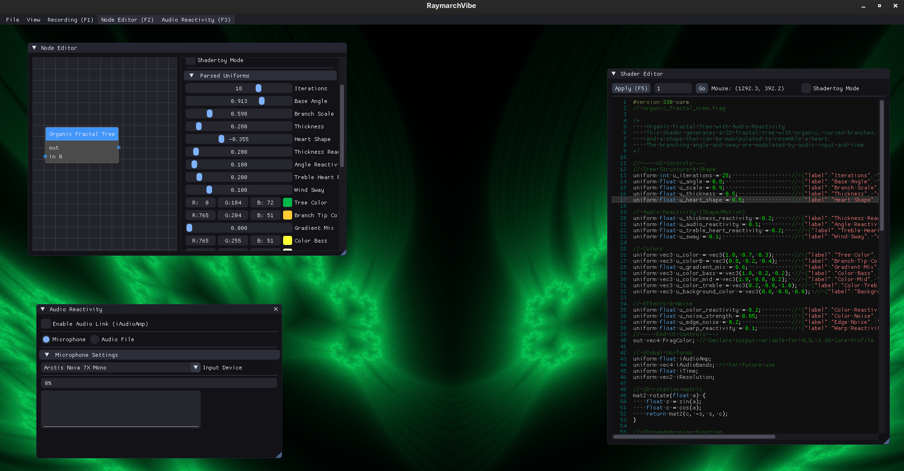

# RaymarchVibe ✨ BETA/EXPERIMENTAL



RaymarchVibe is a real-time SDF / raymarching shader tool for creative coding, in the demoscene spirit. Build effects by connecting shaders in a node graph, tweak their parameters live, and make them react to music.

Repository: <https://github.com/nicthegreatest/raymarchvibe>

## Features

*   **Node-based effects:** chain shaders in a node graph to build multi-pass effects.
*   **Live shader editor:** GLSL syntax highlighting, line numbers and error markers (ImGuiColorTextEdit). A failed recompile keeps the last working shader on screen.
*   **Automatic UI controls:** add a one-line JSON comment to a uniform and get a slider or colour picker.
*   **Colour palettes:** palette-aware colour pickers generate harmonious palettes (complementary, triadic, analogous, split-complementary, square, monochromatic) with optional gradients.
*   **Audio reactivity:** shaders get `iAudioAmp` and normalised 0..1 bands, `iAudioBands` (raw) and `iAudioBandsAtt` (snap attack, ~250 ms decay): `.x` bass, `.y` mids, `.z` treble, `.w` overall. See [AUDIO_REACTIVITY.md](documentation/AUDIO_REACTIVITY.md).
*   **10-band graphic equaliser:** a Winamp-style EQ with a response curve and an on/off toggle, for tuning what the shaders react to.
*   **Spectrum analyser:** a log-frequency spectrum display with rainbow colouring.
*   **Audio Reactivity panel:** grouped into *Now Playing*, *Spectrum* and *Equalizer* cards.
*   **Video & audio recording:** record to MP4 or MOV (H.264, with AAC or lossless ALAC audio) through a built-in FFmpeg backend.
*   **Scene saving:** save and load the whole workspace (node graph, shader code, parameters) as JSON.
*   **Shadertoy import:** fetch shaders from Shadertoy.com by ID or URL and use them as nodes.
*   **UI themes:** several built-in themes.

## Dependencies

RaymarchVibe needs a C++17 compiler, CMake 3.15+ and OpenGL 3.3+ drivers.

Downloaded and built from source by CMake's `FetchContent` on the first configure: GLFW 3.4, Dear ImGui v1.90.8, ImGuiColorTextEdit (pinned commit), nlohmann/json v3.11.3, cpp-httplib v0.15.3 and miniaudio (unpinned — no tag is set, so it follows upstream's default branch).

Vendored in this repository, so nothing to download: GLAD (`src/glad.c`, headers in `include/glad/`), imnodes and ImGuiFileDialog (`vendor/`), stb_image (`vendor/stb/`) and the dj_fft FFT headers (`vendor/dj_fft/`).

GLM is system-first: CMake tries `find_package(glm)` and only downloads a pinned copy (tag 1.0.1) if no system install exists. `libglm-dev` is therefore optional; pass `-DRAYMARCHVIBE_FETCH_GLM=OFF` to require the system package instead.

FFmpeg n5.1.2 is also downloaded and compiled from source on the first build (`ExternalProject`, static, H.264 through libx264). That takes a while, and is why `libx264-dev` is required below.

The GLFW here is built from source, Wayland included, so GLFW's own X11/Wayland dependencies are needed — the `libglfw3-dev` package is not used at all.

**System packages (Debian/Ubuntu):**

```bash
sudo apt update
sudo apt install build-essential cmake libglm-dev libgl1-mesa-dev \
    libx11-dev libxrandr-dev libxi-dev libxcursor-dev libxinerama-dev \
    libxkbcommon-dev libwayland-dev libwayland-bin wayland-protocols \
    libasound2-dev libssl-dev libx264-dev
```

*   `libgl1-mesa-dev` provides the OpenGL headers; the X11, Wayland and `libxkbcommon-dev` packages are what the source-built GLFW needs. Without `libwayland-bin` (which supplies `wayland-scanner`) the configure step stops at `Failed to find wayland-scanner`.
*   `libglm-dev` is optional (see above).
*   `libssl-dev` is only needed for HTTPS Shadertoy fetching (configure with `-DRAYMARCHVIBE_ENABLE_SSL=OFF` to build without it).
*   `libasound2-dev` provides the ALSA headers used by miniaudio for audio input; `libx264-dev` is required by the locally built FFmpeg.

## Build Instructions (Linux)

1.  Clone the repository:
    ```bash
    git clone https://github.com/nicthegreatest/raymarchvibe
    cd raymarchvibe/
    ```

2.  Install dependencies (if not already present) — see [Dependencies](#dependencies) for the package list and what each one is for.

3.  Configure with CMake:
    Create a build directory and run cmake from within it.
    ```bash
    mkdir build
    cd build
    cmake ..
    ```
    *   If you wish to disable HTTPS for Shadertoy fetching, you can turn off the SSL option from within the `build` directory:
        ```bash
        cmake .. -DRAYMARCHVIBE_ENABLE_SSL=OFF
        ```

4.  Build the project:
    From within the `build` directory, run `make` with one job per available core:
    ```bash
    make -j"$(nproc)"
    ```
    The first build also compiles FFmpeg, so it takes a while. On a machine with little RAM, use a lower number (for example `make -j2`) — several files are large and a high job count can exhaust memory.

5.  Run RaymarchVibe:
    The executable is located in the `build` directory.
    ```bash
    ./RaymarchVibe
    ```

#### Command-line flags

RaymarchVibe supports optional flags to speed up debugging and iteration:

- `-verbose=ON|OFF` (also `-v`, `--verbose`): Enables verbose terminal logging. If a value is omitted, the presence of the flag enables verbose mode.
  Examples:
  ```bash
  ./RaymarchVibe -verbose=ON
  ./RaymarchVibe -v
  ```

- `-load=PATH` (also `--load PATH` or `--load=PATH`): Load a fragment shader on startup.
  Examples:
  ```bash
  ./RaymarchVibe -load=shaders/raymarch_v2.frag
  ./RaymarchVibe --load /absolute/path/to/shader.frag
  ```

Notes:
- Paths beginning with `/shaders/...` are treated as relative to the current working directory (e.g. `./shaders/...`).
- If the provided shader fails to compile, the app will still start and show the error in the Console and mark lines in the editor.
- If no flag is provided, the default shader is `shaders/raymarch_v2.frag`.

## Documentation

| Document | What it covers |
|---|---|
| **[documentation/SHADERS.md](documentation/SHADERS.md)** | **Start here.** Shader format, uniforms, UI controls, palettes, rules and testing |
| [documentation/SHADER_WORKFLOW.md](documentation/SHADER_WORKFLOW.md) | The four-stage way to make a shader: visual pass → reactivity plan → audio pass → EQ tuning, with prompts and checklists |
| [documentation/AUDIO_REACTIVITY.md](documentation/AUDIO_REACTIVITY.md) | Audio bands, conditioning, beats, mapping and tuning with the EQ |
| [documentation/SHADER_TECHNIQUES.md](documentation/SHADER_TECHNIQUES.md) | Rendering techniques and quality references |
| [documentation/PALETTE_FEATURE.md](documentation/PALETTE_FEATURE.md) | The palette colour picker in depth |
| [documentation/CHANGELOG.md](documentation/CHANGELOG.md) | Version history |
| [documentation/TODO.md](documentation/TODO.md) | Planned features and improvements |
| [AGENTS.md](AGENTS.md) | Guidance for AI coding agents working on this repo |
| [shaders/templates/](shaders/templates/) | Starter shaders, including `visual_starter.frag` and `audio_reactive_starter.frag` |

## Planned Features

See [TODO.md](documentation/TODO.md) for the full list.

## Development Notes

### Working with Shaders

The build copies the whole source `shaders/` directory into the build directory as a post-build step of the `RaymarchVibe` target, which is where the application loads shaders from.

That copy is not yet declared as depending on the `.frag` files (see the shader-copy item in [TODO.md](documentation/TODO.md)), so it only runs when the `RaymarchVibe` target itself is relinked. A shader-only edit is therefore **not** picked up by a plain `make` — force the copy yourself from the `build/` directory:

```bash
cmake -E copy_directory ../shaders shaders
```

or configure and build a clean build directory:

```bash
rm -rf build && mkdir build && cd build && cmake .. && make -j"$(nproc)"
```

You only need to re-run `cmake ..` before `make` if you add or remove C++ source files or change the project's structure in `CMakeLists.txt`.

## License

Copyright 2025 https://github.com/nicthegreatest/

This program is free software: you can redistribute it and/or modify it under the terms of the GNU General Public License as published by the Free Software Foundation, either version 3 of the License, or any later version. This program is distributed in the hope that it will be useful, but WITHOUT ANY WARRANTY; without even the implied warranty of MERCHANTABILITY or FITNESS FOR A PARTICULAR PURPOSE. See the GNU General Public License for more details. See <http://www.gnu.org/licenses/>.
